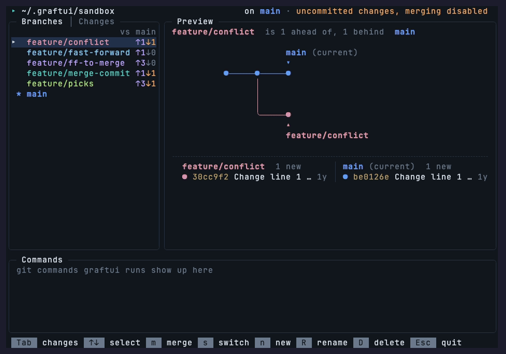
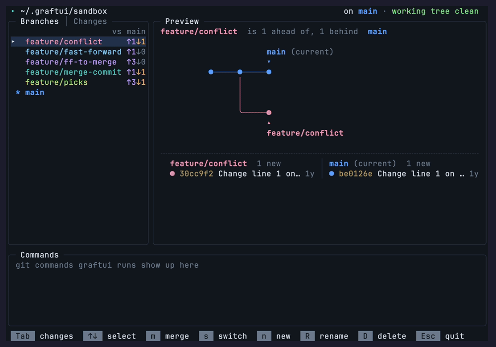

<div align="center">

<h1>graftui</h1>

<p><b>Watch your branches grow together.</b><br/>
An animated git TUI: merge, stage, commit, stash, switch and undo, and see the real <code>git</code> commands as they run.</p>

<p>
  &nbsp;&nbsp;
  &nbsp;&nbsp;
  &nbsp;&nbsp;
  &nbsp;&nbsp;
  &nbsp;&nbsp;
  <a href="https://github.com/0xmmhh/graftui/actions/workflows/ci.yml"></a>
</p>

<p>
  <a href="#install">Install</a> ·
  <a href="#quick-start">Quick start</a> ·
  <a href="#usage">Usage</a> ·
  <a href="#safety">Safety</a> ·
  <a href="#contributing">Contributing</a>
</p>


</div>

<br/>

graftui is a thin, safety-first layer over the git CLI. Every action is a real `git` command, listed in the Commands pane as you would type it. Press `v` for the exact list, with exit codes and git's output.

> **graftui is in alpha.** It is early and not finished, so things may change. Feedback is very welcome: [open an issue](https://github.com/0xmmhh/graftui/issues), or see [Help wanted](#help-wanted).

## What it does

- **Animated merges.** Every outcome has its own animation: fast-forward, merge commit, already up to date, conflict and refused.
- **Branches tab.** Local branches with ahead/behind counts and a preview of how the selected one relates to the current branch. Switch, create, rename and delete branches from the list, each with its own animation.
- **Changes tab.** Stage and unstage files one at a time or all at once, commit, and amend. A three-area animation shows the working tree, the staging area and the repository.
- **Discard, stash and pop.** Discard is always recoverable: the change is saved as a stash entry before the file is put back. Stash takes everything, untracked files included, and pop brings it back.
- **Undo.** `u` steps back through graftui's own actions, one at a time, on either tab.
- **One colour per branch.** A branch has the same colour wherever it appears.
- **Nothing hidden.** The Commands pane lists every git command that ran, and `v` shows the exact list.
- **Safe by default.** Refuses to merge over uncommitted work or a detached HEAD, offers to stash, merge and pop your changes instead, and aborts conflicts so the repo is never left mid-merge.
- **Practice sandbox.** `graftui --sandbox` builds a throwaway repo with a branch for each kind of merge.
- **Five themes.** Pick one with `--theme`.

## Install

graftui has no packaged release yet. You need git and the [.NET 10 SDK](https://dotnet.microsoft.com/download).

On macOS and Linux, clone the repo and run the install script:

```bash
git clone https://github.com/0xmmhh/graftui.git
cd graftui
./dev install
```

`./dev install` publishes a Release build to `~/.local/share/graftui` and writes a small `graftui` launcher to
`~/.local/bin`. If `~/.local/bin` is not on your `PATH`, it prints the line to add. Then run `graftui --help`.

- **Update:** `git pull && ./dev install`
- **Uninstall:** `rm ~/.local/bin/graftui && rm -rf ~/.local/share/graftui`
- **Upgrading from the old single-file install:** `./dev install` won't overwrite a `~/.local/bin/graftui` it didn't write. Delete that file first, then run `./dev install`.
- **Other setups:** `dotnet publish src/graftui -c Release -o <folder>` builds graftui into any folder. Put that folder on your `PATH`.

Windows is not supported yet (`work in progress`). macOS and Linux are.

## Quick start

Try it on the practice repo first:

```bash
graftui --sandbox
```

This rebuilds a repository at `~/.graftui/sandbox` and opens it. In a fresh sandbox, each branch gives a different kind of merge into `main`:

| Branch | Merging it gives |
|---|---|
| `feature/fast-forward` | Fast-forward |
| `feature/ff-to-merge` | Fast-forward onto a merge commit |
| `feature/merge-commit` | Merge commit |
| `feature/conflict` | Conflict (aborted automatically) |
| `feature/picks` | Merge commit (three commits ahead) |

Merging one of them changes `main`, so run `--sandbox` again any time to reset it. graftui only ever deletes a folder it created itself (marked by `.git/graftui-sandbox`).

Then, in any repository of your own:

```bash
graftui                 # the repo in the current directory
graftui path/to/repo    # or a specific one
```

## See it

### Conflicts are aborted for you

A conflicting merge is aborted, and the Commands pane shows `git merge` and `git merge --abort`.


### Stage and commit

The Changes tab: staging a file, staging the rest, and committing.



### Undo

A merge commit, then `u` undoes it.



### Switch branches

Switching to `feature/picks` and back. Each branch keeps its colour.


## Usage

```
graftui [options] [path-to-repo]
graftui --sandbox [options]
graftui --help
graftui --version
```

| Option | Meaning |
|---|---|
| `--sandbox` | Rebuild the practice repo at `~/.graftui/sandbox` and open it. It can't be combined with a path |
| `--theme <name>` | Colours: `default`, `lifted`, `muted`, `high-contrast` or `light`. Names are case-insensitive. It combines with `--sandbox` and a path (`--theme=<name>` works too) |
| `--version` | Print the version and exit |
| `-h`, `--help` | Print the usage and the keys, then exit |

**Both tabs**

| Key | Action |
|---|---|
| `Tab` | Switch between Branches and Changes |
| `↑` / `↓` | Select a branch (Branches) or a file (Changes) |
| `u` | Undo the last step, on either tab |
| `v` | Switch the Commands pane between the simplified list and the exact list |
| `Esc` | Quit. If a merge, a commit or another change is running, graftui waits for it to finish first |

**Branches**

| Key | Action |
|---|---|
| `m` | Merge the selected branch into the current one. With uncommitted changes, asks first whether to stash them, merge and pop them back |
| `s` | Switch to the selected branch. Changes that don't collide come along |
| `n` | New branch at the current tip, from a one-line name box |
| `R` | Rename the selected branch, the current one included |
| `D` | Delete the selected branch, after a question. An unmerged one asks twice |
| `r` | Rebase the current branch onto the selected one, after a confirm screen (Enter runs it, Esc cancels) |

**While a rebase is paused** (a conflict, an edit or a reword stop), the Branches tab shows the pause and takes these keys:

| Key | Action |
|---|---|
| `Enter` | Continue. A conflict continues once its file is resolved in your editor (the list updates by itself); an edit stop is amended and continued; a reword or squash keeps its message |
| `S` | Skip the conflicted commit (conflicts only) |
| `X` | Abort the rebase, after a question (`y` aborts, `n` keeps going). The branch goes back to its old tip |
| `Tab` / `Esc` | Changes tab / quit. Quitting leaves the rebase paused: the terminal says what to run next, and exits 1 for a conflict |

The other branch keys are refused until the rebase is finished or aborted. On the Changes tab you can still stage and unstage (for an edit stop, stage the change first), but commit, amend, discard, stash, pop and undo wait for the pause to end.

**Changes**

| Key | Action |
|---|---|
| `Space` | Stage or unstage the selected file |
| `a` / `U` | Stage all / unstage all |
| `c` / `A` | Commit what is staged / amend the last commit |
| `x` | Discard the unstaged change to the selected file, after a question |
| `z` / `Z` | Stash everything / pop the newest stash entry |

**In a box or a question**

| Key | Action |
|---|---|
| `Enter` | Save or create. In a commit box, commits from the subject line |
| `Tab` | Next field (from the subject to the body) |
| `Ctrl+Enter` or `Ctrl+J` | Commit from either field, if your terminal sends them |
| `Esc` | Cancel |
| `y` / `n` | Answer a question. `n` or `Esc` cancels at any step |
| `1` / `2` | Answer the second and third confirmations. Deleting an unmerged branch asks `y` then `1`; amending a pushed commit asks `y`, `1` then `2` |

<details>
<summary>The Branches tab</summary>

- **Switch** (`s`) checks out the selected branch with `git switch --no-guess`. Uncommitted changes come along when git can carry them. A change that git would overwrite (the same file changed on both sides) is refused before anything moves, and the file is named. A switch is not undoable.
- **New** (`n`) creates a branch at the current tip and switches to it (`git switch -c`). A box asks for the name: Enter creates it, Esc cancels. An invalid or existing name keeps the box open with the reason. It is refused on a detached HEAD or in a repo with no commit.
- **Rename** (`R`) renames any branch, the current one included (`git branch -m`). The box starts with the old name. A branch's upstream follows the new name.
- **Rebase** (`r`) puts the current branch's own commits onto the selected branch. The confirm screen lists the commits that will get new hashes. Enter runs `git rebase`, which graftui writes as a todo list so no editor opens, and a backup is saved as an undo step, so `u` brings the old tip back. A fast-forward has nothing to rebase, and the current branch itself can't be rebased onto itself; git's own refusals (a dirty tree, a merge commit in the range, unrelated history) are shown as they are. A conflict pauses the rebase on its screen: resolve the file in your editor, then Enter continues, or X aborts and the branch is left as it was. A paused rebase is still paused after a restart.
- **Delete** (`D`) refuses the current branch. A branch that is already in the current branch gets one question and `git branch -d`. An unmerged one gets two questions, answered `y` and then `1`, and `git branch -D`. Its tip is recorded, so `u` brings it back at the same commit. Undoing a delete restores the branch's commit, not its config (for example its upstream).
- **Stash, merge, pop** (`m` over uncommitted changes): "You have 3 uncommitted changes. Stash them, merge feature/x into main, then pop them back?" `y` stashes everything (untracked files included), merges, and pops the changes back with `git stash pop --index`, so staged changes stay staged. If the merge conflicts, it is aborted and your changes are put back exactly as they were. If the pop conflicts, the merge stands and your changes stay in `stash@{0}`; `Z` tries the pop again and `u` undoes the merge.
- **Undo** (`u`) covers branch create, rename and delete and the stash-merge-pop, like the other steps.

</details>

<details>
<summary>The Changes tab</summary>

- **Changes (left):** the staged files, then the unstaged ones (`M` modified, `A` added, `D` deleted, `R` renamed, `?` untracked, `U` conflicted). The right pane shows the selected file's diff, with each hunk marked as `── line N ──` (the line where it starts in the file), and under it one line with HEAD and the stash count. During a change the three areas animate: the working tree, the staging area and the repository.
- **Staging** moves a file between the working tree and the staging area. Each move is animated and logged with its `git add`, `git restore --staged` or `git rm --cached`. Nothing is ever discarded: the edit stays in your working tree.
- **Committing** opens a message box in the art pane. Type a subject, press `Tab` to reach the body, and press `Enter` to commit (Enter in the body adds a line). `Ctrl+Enter` or `Ctrl+J` saves from either field, if your terminal sends them. `Esc` cancels.
- **Amending** starts from the last commit's message. If that commit is already on a remote branch, graftui asks three escalating questions first: "Are you sure?" (answer `y`), "Are you really sure?" (answer `1`) and "Last chance, are you still sure?" (answer `2`). Any other key is ignored; `n` or `Esc` cancels at any step. graftui never force-pushes; after an amend you run `git push --force-with-lease` yourself.
- **Unstaging hand-picked changes.** A staged file that also differs in the working tree (you staged one version, then edited again) has a staged version that exists only in the index. Unstaging it asks first: "<file> has hand-picked staged changes; unstage them all?" (`y` or `n`). `U` asks once for all of them. `u` restores the exact staged version.
- **Discard** (`x`) asks first. graftui saves the unstaged change as a stash entry named `graftui: discarded <file>`, then puts the file back. A partly staged file keeps its staged part in the index, and a new file is removed. `git stash list` shows the entry, and `u` brings the change back.
- **Stash** (`z`) takes every change, untracked files included (`git stash push -u`). A one-line box asks for a message; Enter with it empty uses git's default message.
- **Pop** (`Z`) runs a plain `git stash pop`: the changes come back unstaged. The exception is the stash-merge-pop's own entry, which `Z` pops with `git stash pop --index` so staged changes stay staged. If git refuses `--index` because the staged part cannot apply, the plain pop runs only when it loses nothing (for every file, the staged and working-tree versions are the same), and the caption says the staged changes came back unstaged. Otherwise `Z` refuses, names the files whose staged changes would be lost, and keeps the stash entry (`git stash show -p` shows it). If git cannot apply the entry, graftui puts the working tree and index back exactly as they were, keeps the stash entry, and lists the conflicting files. The repository is never left with conflict markers.
- **Undo** (`u`) reverses the newest graftui step, one step per press, newest first: commit, amend, merge, discard, stash, pop, the hand-picked unstage, and the branch steps (create, rename, delete) and stash-merge-pop. It refuses when undoing would overwrite something that changed since (the refusal names the file or branch). Undo steps are commits under `refs/graftui/undo/`, so `git log --all`, gitk and other git GUIs show them (as "graftui undo: …"). They are harmless, and only the last 50 are kept.
- **Refusals** are shown in the caption and logged: nothing staged (for a commit, `c`; amend `A` works with nothing staged), an empty subject, a conflicted file, a nested repository, an unfinished merge, rebase, cherry-pick or revert, a submodule, or a detached HEAD.

</details>

<details>
<summary>The screen</summary>

- **Status bar (top):** the repository (shown as `▸ ~/.graftui/sandbox`), the current branch, and whether the working tree is clean. When merging is disabled, the bar says why.
- **Branches (left):** every local branch. `▸` marks the selected row and `*` the current branch. `↑2` means the branch has 2 commits the current branch lacks; `↓1` means the current branch has 1 commit the branch lacks. The column is headed `vs <current branch>`.
- **Preview and animation (right):** how the selected branch relates to the current one, a picture of the two branches, a caption and the commits involved. The commits are listed side by side: the selected branch's on the left, the current branch's on the right, under headers in each branch's colour. Each row shows a short age (`2h`, `3d`, `5w`), and each list shows as many of its newest commits as fit. Narrower terminals (under 70 columns) stack them. During a merge the two lines grow together; afterwards it shows the result.
- **Commands:** the git commands graftui ran, each as the command you would type (`$ git merge feature/x  ✔`), with git's output. A failed command is shown exactly, with its exit code. Press `v` to see the exact list instead: every git call, with its exit code and the reads graftui hides by default. Each saved undo step shows as `↶ saved an undo step (u)`. The `v` hint sits on the pane's border.
- **Key bar (bottom):** the keys that work right now.

**Branch colours.** Each branch has one colour. It colours the branch's name in the list, its line and label in the graph, and its commit-list header. `main` (or `master`, when there is no `main`) is always the first colour, blue in every theme. The other branches get their colour from their name, so a branch keeps its colour when you select it or switch to it. Neighbours in the list never share a colour. With more than five other branches, colours repeat. Selecting or switching never changes a colour. Adding or removing a branch can shift another branch's colour when two names want the same one. The merge commit's `◉` is gold.

The terminal must be at least 64×22. Names that don't fit are cut with `…`.

</details>

<details>
<summary>What a merge can do</summary>

| Outcome | What you see | What happens in the repo |
|---|---|---|
| Fast-forward | `✔ Fast-forward: main is now at 1a2b3c4 (+1 commit, no merge commit)` | The current branch moves to the selected branch's tip |
| Merge commit | `✔ Merge commit 1a2b3c4 created on main` (gold `◉` at the join) | A merge commit is created with git's default message |
| Already up to date | `Already up to date: feature/x is already part of main` | Nothing |
| Conflict | `✕ CONFLICT in app.txt: merge aborted, main unchanged` | graftui runs `git merge --abort` and lists the conflicting files. The repo is back where it was |
| Failed | `✕ Merge failed: <reason>` | git refused or something went wrong; graftui reports what state the repo is in |

graftui works out the outcome from the commit graph (did `HEAD` move, to which commit, with how many parents), not by parsing git's localised output.

</details>

<details>
<summary>When graftui refuses to merge</summary>

graftui stops without running `git merge` when:

- the working tree has uncommitted changes (including untracked files). On the Branches tab, `m` asks instead whether to stash them, merge and pop them back
- `HEAD` is detached
- a merge is already in progress (graftui never aborts a merge it didn't start)
- you selected the current branch
- the current branch has no commits yet
- the branch name is shadowed by a tag or other ref of the same name
- the branch name starts with `-`

</details>

<details>
<summary>Exit codes</summary>

| Code | Meaning |
|---|---|
| `0` | Normal exit, `--help`, `--version`, or a merge that succeeded |
| `1` | Startup error (not a repository, folder not found, git not on `PATH`, `--sandbox` refused), a UI error, or a merge that finished after you quit and ended in a conflict or failure. Also `1` when the latest change was a stash-merge-pop that conflicted or failed, even if you saw it on screen |
| `2` | Bad command line (unknown option, too many arguments, unknown theme) |

</details>

## Safety

- **Never left mid-merge.** On conflict, graftui always runs `git merge --abort` (falling back to `git reset --merge`) and then checks that the tree is clean with no `MERGE_HEAD`.
- **Never resets your work.** The rollback only runs when graftui's own merge actually started and `HEAD` hasn't moved. Changes graftui didn't make are reported, never discarded.
- **Staging and committing never discard work.** Stage and unstage only move entries in the index, and the work tree is never touched. A failed commit leaves `HEAD`, the index and your files as they were. graftui never force-pushes.
- **Discard is recoverable.** Before a file's unstaged change is removed, it is saved as a stash entry (`graftui: discarded <file>`) and `u` brings it back. The discard is refused when the change can't be saved safely (a submodule, a nested repository, an intent-to-add file or a conflict).
- **Undo never overwrites.** `u` checks that the state a step left behind is still there, and refuses otherwise. Nothing is dropped silently: a refused step stays on top until you deal with it.
- **Never waits on an editor, pager or prompt.** graftui sets `GIT_EDITOR=true`, `GIT_PAGER=cat`, `GIT_TERMINAL_PROMPT=0` and `GIT_MERGE_AUTOEDIT=no`, uses `--no-edit`, and closes git's stdin.
- **Interrupted merges are rolled back.** Quit during a merge and graftui waits for git, then prints the outcome and every command. `Ctrl+C` at that point interrupts git, and graftui rolls back the partial merge.
- **Slow git is visible.** If a merge takes more than about 5 seconds (a signing prompt or a slow hook), the caption says `git is still running`.
- **Ignores stray git environment variables.** `GIT_DIR`, `GIT_WORK_TREE` and `GIT_INDEX_FILE` are removed, so graftui always works on the repo you gave it.

<details>
<summary>Known limitations</summary>

- `m` merges immediately; there is no confirmation step.
- Your git config applies. `merge.ff=only` turns diverged merges into failures; `merge.ff=false` turns fast-forwards into merge commits. Commit signing with a passphrase-protected key and no gpg-agent running will show a prompt over the TUI.
- Like plain `git merge`, a merge can overwrite *ignored* files (such as a local `.env`) if the incoming branch tracks them.
- The command log follows the latest output and can't be scrolled by hand.
- A signing prompt (pinentry) or a hook that opens the terminal can draw over the TUI during a commit or a merge. graftui waits for git either way, and the caption says `git is still running` after about 5 seconds.
- Non-ASCII file names in the conflict list are shown git-quoted.
- At 80 columns some keys drop off the key bar. They still work.
- graftui doesn't watch the repo. A `HEAD` changed in another terminal shows up after graftui's next action.
- Colours repeat beyond five branches besides the trunk.
- Windows is not supported yet.

</details>

## Status and plans

Early but usable for everyday local work: merges, the Changes tab (stage, unstage, commit, amend, discard, stash and pop), the Branches tab (switch, create, rename and delete), and multi-step undo. Planned next, roughly in this order (ideas, not promises):

1. **A settings file** for speed, animations on or off, the theme and key bindings
2. **Windows support**
3. **Remotes**: fetch, pull (fast-forward first) and push (never forced), with ahead/behind against `origin`
4. **History tools**: cherry-pick, rebase, and a choice of merge types (no-ff, ff-only, squash, linear)
5. **The smart layer**: a forecast of what each key would do, resolving conflicts inside graftui, interactive rebase, a whole-repo graph view, and plain-English explanations of each command
6. **A packaged release**, installable with `dotnet tool install -g graftui`
7. **Desktop app**: cross-platform desktop application made with Avalonia (tbc.)

## Help wanted

There is a lot planned, and help is welcome. Some examples:

- **Performance and optimisation.** Faster startup, and faster reads on large repositories.
- **A desktop app,** made with Avalonia (item 7 above).
- **A VS Code extension.**
- **Testing on Linux, and Windows support** (item 2 above). Reports from more systems help a lot.

Open an issue to talk about any of these first, or send a small pull request. [CONTRIBUTING.md](CONTRIBUTING.md) explains how to start.

## Development

```bash
dotnet build graftui.slnx
dotnet test graftui.slnx
dotnet run --project src/graftui -- --sandbox            # rebuild and open ~/.graftui/sandbox
```

Develop against the sandbox, never against the graftui repository itself. Warnings are errors, and nullable reference types are on for every project. The GIFs in this README are recorded with [vhs](https://github.com/charmbracelet/vhs) from the tapes in `assets/`.

[CONTRIBUTING.md](CONTRIBUTING.md) covers the setup, `./dev`, the safety rules every change must keep, and how to record the GIFs. [ARCHITECTURE.md](ARCHITECTURE.md) explains how the code fits together.

## Contributing

Contributions are welcome: bug reports, ideas and pull requests.

- **Found a bug?** [Open an issue](https://github.com/0xmmhh/graftui/issues) with what you did, what you expected and what happened. Include the Commands pane output if it's relevant: press `v` for the exact list of every git command graftui ran.
- **Have an idea?** Open an issue before starting anything big, so we can agree on the approach first. The plans above are a good place to start.
- **Sending a pull request?** Keep it focused on one change, make sure `dotnet build` has no warnings and `dotnet test` passes, and add a test for anything that changes how graftui touches a repository.

See [CONTRIBUTING.md](CONTRIBUTING.md) for the setup, the safety rules every change must keep, and how to test.

## License

[MIT](LICENSE)
